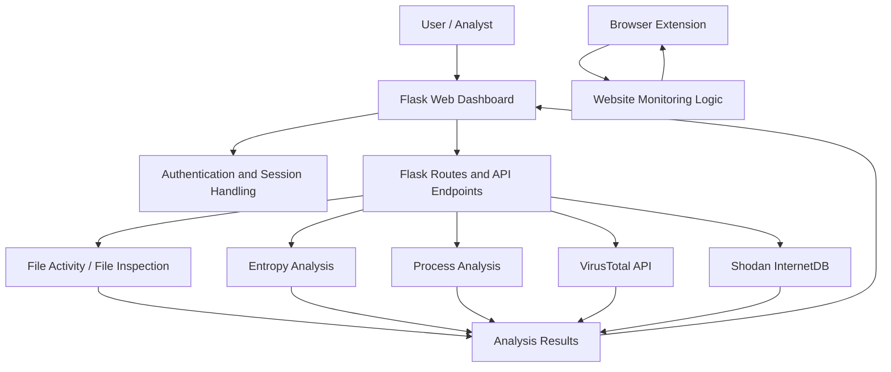
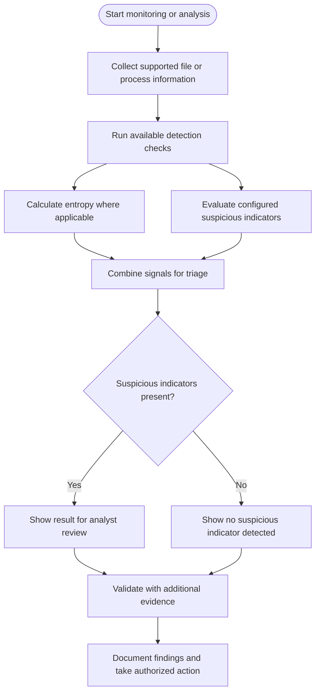
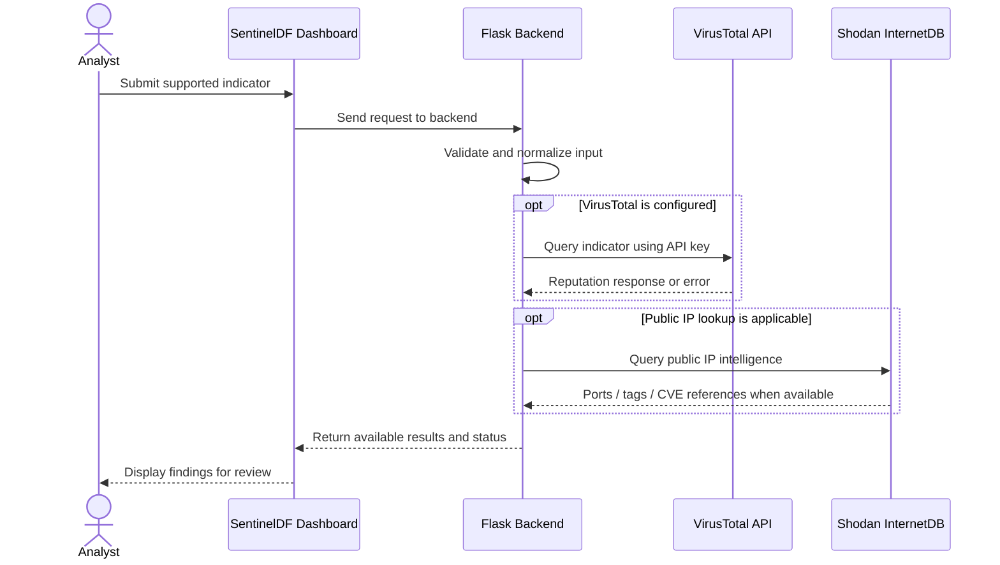

# SentinelDF — Security Monitoring & Threat Intelligence Platform

<p align="center">
  <strong>A Python Flask-based security monitoring project for learning, experimentation, and SOC-style analysis.</strong>
</p>

<p align="center">
  
  
  
  
</p>

SentinelDF is a local web application that brings together file-activity monitoring, ransomware-oriented heuristics, process inspection, and external threat-intelligence lookups in one dashboard. It is intended as a learning and portfolio project for exploring defensive security workflows.

> **Important:** SentinelDF is a work in progress. Detection results are heuristic and should not be treated as proof that an item is malicious or safe. Run it only on systems and networks you own or are authorized to monitor.

---

## Contents

- [Overview](#overview)
- [Features](#features)
- [Architecture](#architecture)
- [Detection workflow](#detection-workflow)
- [Threat-intelligence workflow](#threat-intelligence-workflow)
- [Interface screenshots](#interface-screenshots)
- [Technology stack](#technology-stack)
- [Project structure](#project-structure)
- [Requirements](#requirements)
- [Installation and setup](#installation-and-setup)
- [Configuration](#configuration)
- [Running SentinelDF](#running-sentineldf)
- [Browser extension](#browser-extension)
- [Security considerations](#security-considerations)
- [Limitations](#limitations)
- [Future improvements](#future-improvements)
- [Disclaimer](#disclaimer)

## Overview

SentinelDF provides a single web interface for reviewing several security signals. The current project includes:

- File activity and suspicious-file checks using heuristic analysis.
- Entropy analysis to help identify files that may warrant further ransomware investigation.
- Process inventory/analysis helpers.
- VirusTotal lookups when a valid API key is configured.
- Shodan InternetDB IP intelligence lookups.
- A Flask dashboard with login, signup, and password-recovery pages.
- A browser extension component for website-monitoring functionality.

The exact features available at runtime depend on the local configuration, installed dependencies, permissions, and whether external API credentials have been configured.

## Features

| Component | Purpose | Notes |
|---|---|---|
| File activity monitoring | Surface file-related activity for investigation | Not a substitute for endpoint telemetry or a full EDR agent |
| Ransomware-oriented heuristics | Flag patterns that may be suspicious | Heuristics can produce false positives and false negatives |
| Entropy analysis | Measure file entropy as one signal in suspicious-file analysis | High entropy alone does not prove ransomware; compressed and encrypted legitimate files may also have high entropy |
| Process analysis | Inspect process-related information for triage | Visibility depends on operating-system permissions and implementation |
| VirusTotal integration | Query supported file, URL, or IP reputation endpoints | Requires a valid `VIRUSTOTAL_API_KEY`; service limits and terms apply |
| Shodan InternetDB | Retrieve public IP intelligence such as observed ports and available vulnerability references | Results may be incomplete or out of date; private/reserved IPs are not suitable for public IP lookups |
| Web dashboard | Present monitoring and intelligence results in one place | Runs as a Flask web application |
| Authentication pages | Provide login, signup, and password-recovery interfaces | Review the authentication implementation before exposing the app to other users |
| Browser extension | Support website-monitoring functionality | Install and test only in a browser/profile you control |

## Architecture

The following diagrams describe the intended high-level flow of the current project. They are conceptual diagrams, not a guarantee that every component is enabled in every configuration.

### System architecture



### Detection and triage workflow



**Interpretation:** a “no suspicious indicator detected” result is not proof that a file is safe. Use multiple signals and independent validation.

### Threat-intelligence lookup flow



External services may rate-limit requests, return partial data, or be unavailable. Do not treat reputation results as a definitive verdict.

## Interface screenshots

GitHub can display screenshots directly in this README. To add **real screenshots from your running application**, create the folder below and save your screenshots with the matching names:

```text
docs/
└── screenshots/
    ├── dashboard.png
    ├── login.png
    ├── threat-intelligence.png
    └── detection-results.png
```

Then uncomment the image lines below after adding the files. Use screenshots from your own running SentinelDF instance; do not use mock images as evidence of implemented functionality.

<!-- Uncomment after adding docs/screenshots/dashboard.png
### Dashboard

-->

<!-- Uncomment after adding docs/screenshots/login.png
### Login page

-->

<!-- Uncomment after adding docs/screenshots/threat-intelligence.png
### Threat intelligence panel

-->

<!-- Uncomment after adding docs/screenshots/detection-results.png
### Detection results

-->

**Screenshot tips**
1. Run SentinelDF locally and open `http://127.0.0.1:5000`.
2. Capture the dashboard, login page, and a real successful threat-intelligence lookup.
3. Hide email addresses, tokens, API keys, internal IPs if sensitive, and any personal data before committing screenshots.
4. Save PNG files in `docs/screenshots/` using the names above.
5. Add them to Git with `git add docs/screenshots README.md`, then commit and push.

## Technology stack

- **Python** — application logic and analysis modules.
- **Flask** — web server, routing, and dashboard backend.
- **HTML / CSS / JavaScript** — web interface.
- **VirusTotal API** — optional threat-intelligence lookups.
- **Shodan InternetDB** — public IP intelligence lookups.
- **Browser extension APIs** — extension-side website monitoring.

## Project structure

```text
RansomwareDetector/
├── app.py
├── detector.py
├── entropy_analyzer.py
├── process_analyzer_fixed.py
├── browser_extension/
│   ├── background.js
│   └── manifest.json
├── static/
│   ├── script.js
│   └── style.css
├── templates/
│   ├── index.html
│   ├── login.html
│   ├── signup.html
│   └── forgot_password.html
├── docs/
│   └── screenshots/
├── .gitignore
└── README.md
```

The layout above reflects the main files tracked in the repository; optional files and local environment files may differ.

## Requirements

- Windows, Linux, or another supported Python environment (test the project on your target operating system).
- Python 3.
- Git, if cloning or contributing through Git.
- Internet access for external threat-intelligence queries.
- A valid VirusTotal API key for VirusTotal functionality.
- Browser support compatible with the included extension manifest.

Install only dependencies required by the actual source code. If a `requirements.txt` file is added to the project, use it to install dependencies.

## Installation and setup

### 1. Clone the repository

```bash
git clone https://github.com/27omkar/SentinelDF.git
cd SentinelDF
```

### 2. Create and activate a virtual environment

**Windows CMD:**

```cmd
py -m venv .venv
.venv\Scripts\activate
```

**Linux / macOS:**

```bash
python3 -m venv .venv
source .venv/bin/activate
```

### 3. Install dependencies

Check the imports in the project and install the required packages. For example, Flask is required by the web application:

```bash
python -m pip install Flask
```

Install any additional packages required by your local version of the code. A pinned `requirements.txt` is recommended for reproducible setup.

### 4. Configure environment variables

Set a strong, unique Flask secret key and configure optional integrations as described below. Never commit real credentials to Git.

### 5. Start the application

From the project directory, use the launch command appropriate to the current `app.py`. A typical Flask script entry point can be started with:

```bash
python app.py
```

If your local version uses a different entry point or startup procedure, follow that implementation.

## Configuration

SentinelDF reads sensitive configuration from environment variables. Configure only the values needed for the features you use.

| Variable | Purpose | Required? |
|---|---|---|
| `SENTINELDF_SECRET_KEY` | Flask session signing key | Required for a secure configured deployment |
| `SENTINELDF_EMAIL_FROM` | Sender address for email notifications | Only if email alerts are used |
| `SENTINELDF_EMAIL_TO` | Recipient address for email notifications | Only if email alerts are used |
| `SENTINELDF_EMAIL_APP_PASSWORD` | Email provider app password | Only if email alerts are used |
| `SENTINELDF_USERNAME` | Optional configured login username, if supported by the current app setup | Depends on configuration |
| `SENTINELDF_PASSWORD` | Optional configured login password, if supported by the current app setup | Depends on configuration |
| `SENTINELDF_RECOVERY_CODE` | Optional password-recovery configuration, if enabled | Depends on configuration |
| `VIRUSTOTAL_API_KEY` | VirusTotal API authentication | Required for VirusTotal lookups |

Use your operating system's environment-variable settings or a local `.env` loader if your project explicitly supports one. Do not assume a `.env` file is loaded automatically.

**Windows CMD example** (values apply only to the current terminal session):

```cmd
set "SENTINELDF_SECRET_KEY=replace-with-a-long-random-secret"
set "VIRUSTOTAL_API_KEY=replace-with-your-virustotal-key"
```

Do not paste actual secrets into README files, source code, screenshots, issue reports, or chat messages. If a real key has been exposed in a public repository, revoke or rotate it.

## Running SentinelDF

When the Flask server starts locally, open:

- Local computer: `http://127.0.0.1:5000`

If the server is intentionally bound to `0.0.0.0`, another device on the same trusted LAN may be able to reach it using the host computer's LAN IP address. This does **not** mean that the other device is being monitored. The monitoring logic runs only where the relevant component is installed and operating.

Do not expose the development server directly to the public internet. Use appropriate authentication, TLS, firewall rules, and a production-grade deployment configuration before any broader deployment.

## Browser extension

The repository includes a `browser_extension/` directory. To test it:

1. Open your browser's extension-management page.
2. Enable developer mode if required by the browser.
3. Choose the option to load an unpacked extension.
4. Select the project's `browser_extension/` folder.
5. Test only on websites and browser profiles you are authorized to monitor.

Extension permissions should be reviewed before installation. The behavior and compatibility depend on the manifest and browser version.

## Security considerations

- Keep API keys, email app passwords, session secrets, and user credentials out of source control.
- Use a strong, unique `SENTINELDF_SECRET_KEY`; do not use a predictable fallback in a public or deployed app.
- Avoid running the application with administrator/root privileges unless a specific feature requires it.
- Do not expose the Flask development server to the public internet.
- Treat external API responses as third-party data and validate inputs and outputs.
- Obtain authorization before inspecting devices, files, processes, or network indicators.
- Keep dependencies updated and pin tested versions in a dependency file.
- Review authentication, password recovery, CSRF protections, session settings, logging, and error handling before using the application beyond a personal lab.

## Limitations

- Heuristic detection may miss real threats or flag legitimate activity.
- Entropy is one indicator, not a standalone ransomware verdict.
- VirusTotal and Shodan results depend on service availability, permissions, rate limits, and the data each service has collected.
- A dashboard client is not automatically an endpoint monitoring agent. Other computers require their own authorized telemetry collection if multi-device monitoring is desired.
- A local prototype is not a replacement for a managed EDR, SIEM, or incident-response process.

## Future improvements

Potential improvements for the project include:

- A pinned `requirements.txt` and documented reproducible setup.
- Unit and integration tests for detection and API routes.
- A structured incident queue with severity, status, analyst notes, and evidence.
- Exportable investigation reports.
- Improved audit logging and input validation.
- Multi-endpoint monitoring using authenticated agents and secure transport.
- Windows event log or Sysmon integration.
- Clearer detection explanations, confidence levels, and false-positive handling.
- CI checks for tests, dependency issues, and accidental secret exposure.

## Disclaimer

SentinelDF is provided for educational, research, and authorized defensive-security use. It is not guaranteed to detect every threat and is provided without warranty. You are responsible for using it lawfully, protecting credentials, and validating findings before taking action.
